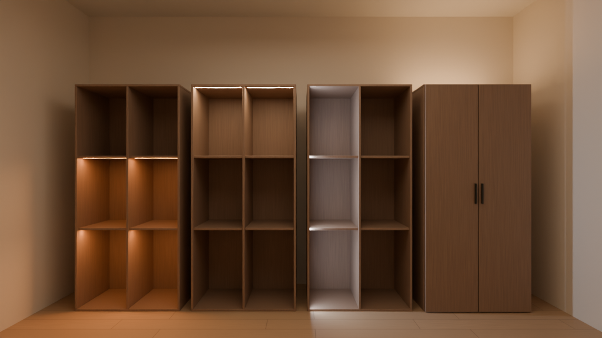

# MyHome

**TR** · Ölçülü oda planını çiz, mobilyaları yerleştir, malzeme ve ışık seç, odanı 3B görüntüle.
**EN** · Draw a room to scale, arrange furniture, choose finishes and lighting, and view the room in 3D.

<!-- publication:start -->
[Web sürümü rehberi / Web guide](docs/start.md#web) · [Windows için indir / Download for Windows](https://github.com/nsevinc/MyHome/releases/latest) · [Kaynak koddan çalıştır / Run from source](#source)
<!-- publication:end -->



## Türkçe

Web sürümünde 2B plan, 3B düzenleme, GLB içe aktarma, LED ışıklar, kamera, PDF, galeri ve **1920 × 1080 PNG** kullanabilirsin. Projeler tarayıcının profilinde ve site adresinde saklanır. Çalışmalarını taşımak için **Proje → Projeyi renderlarla indir** ile yedek al.

Windows x64 ZIP dosyasını tamamen çıkarıp **MyHome.cmd** dosyasını çalıştır. Node.js pakete dahildir. Fotogerçekçi **3840 × 2160 Cycles** için ayrıca Blender 4.5 LTS kur. Web’den veya daha eski bir MyHome kurulumundan aldığın yedeği **Proje → Projeyi aç** ile açabilirsin.

## English

The web edition includes 2D planning, a 3D editor, GLB import, cabinet lighting, saved cameras, PDF, a gallery and **1920 × 1080 PNG** export. Project data stays in the browser profile for that site. Export a backup before changing devices or clearing browser storage. The editor and illustrated guide are in Turkish.

Extract the Windows x64 ZIP and double-click **MyHome.cmd**. Node.js is included. Install Blender 4.5 LTS for **3840 × 2160 Cycles** rendering. In the web app choose **Proje → Projeyi renderlarla indir** (download a project with its images). In the Windows app choose **Proje → Projeyi aç** (open project).

<a id="source"></a>
## Kaynak koddan / From source

Node.js 22.23.5 is the runtime used by CI and the Windows release. From the repository root:

```sh
npm ci
npm run dev
```

[MyHome’u yerelde aç / Open the local editor](http://127.0.0.1:5273/). Windows PowerShell’de `npm.cmd` kullanabilirsin. Run `npm test` for the test suite and `npm run build` for the static site in `dist/`. Use `npm run preview` to test that web edition locally.

[Hızlı başlangıç / Quick start](docs/start.md) · [Windows ve Blender](docs/windows-portable.md) · [GitHub ve Cloudflare yayın adımları / Publishing guide](docs/publishing.md) · [Model kataloğu](docs/catalog.md) · [MIT](LICENSE) · [Third-party notices](docs/notices.md)
