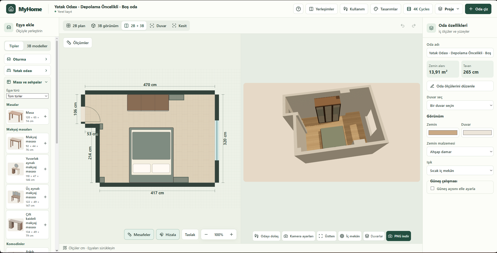

#  MyHome

**Ölçülü oda planı ve 3B iç mekân tasarımı** · [English](#english)

Odanı santimetreyle çiz, mobilyaları planda sürükle ve sonucu yanındaki 3B görünümde incele. Bir gardırobun kirişin altına sığıp sığmadığını veya yatakla dolap arasında ne kadar geçiş kaldığını, eşyaları taşımadan önce görebilirsin.

<!-- publication:start -->
**[Windows için indir / Download for Windows](https://github.com/nsevinc/MyHome/releases/latest)** · [Kaynak koddan çalıştır / Run from source](#source) · [Tarayıcıda aç / Open in browser](https://myhome-nuri-sevinc.pages.dev/)
<!-- publication:end -->

[](docs/screenshots/myhome-editor.png)

*2B + 3B görünümü açık bir yatak odası. Planda kapı açılımını ve duvar ölçülerini okurken sağda yatağın, gardırobun ve pencerenin birbirine göre konumunu görebilirsin.*

## İlk odanı tasarla

1. **Odayı çiz.** Duvar uzunluklarını ve tavan yüksekliğini gir. Kapı, pencere, kolon ve kirişleri ekle. Elinde bir taslak varsa ölçüsünü bildiğin bir duvarı referans alarak çizimini ölçeklendir.
2. **Yerleşimi dene.** Katalogdan bir yatak seç veya kendi GLB modelini ekle. Eşyayı döndür, dolap önünde geçiş alanı ayır ve kapakların açılımını kontrol et. **2B + 3B** ile aynı yerleşimi iki açıdan izle.
3. **Görüntüyü al.** Yüzeylere malzeme ata, ışığı ayarla ve bir kamera açısı kaydet. **PNG indir** ile görüntü al. Kayıtlı kareleri **Proje → Proje renderları** altında yeniden açabilirsin.

## Hangi sürümü kullanmalıyım?

| | Tarayıcı | Windows x64 |
|---|---|---|
| Oda tasarımı | 2B ve 3B düzenleme, katalog, GLB, malzeme ve ışık | Aynı editör ve proje biçimi |
| Görüntü çıkışı | 1920 × 1080 PNG | 1920 × 1080 PNG ve Blender 4.5 LTS ile 3840 × 2160 Cycles render |
| Başlatma | [Web editörünü aç](https://myhome-nuri-sevinc.pages.dev/) ve odanı çizmeye başla | ZIP’i çıkarıp `MyHome.cmd` dosyasına çift tıkla. Node.js pakete dahildir |

**Windows’ta ilk açılış için** sürüm sayfasında **Assets** bölümünden adı `MyHome-Windows-x64-` ile başlayan ZIP’i indir ve tamamını bir klasöre çıkar. Blender’ı 4K Cycles kullanacağın zaman ayrıca kurabilirsin. [Windows ve Blender rehberi](docs/windows-portable.md)

**Projeni taşımak için** menüden **Proje → Projeyi renderlarla indir** seçeneğini kullan. Web projeleri kullandığın tarayıcı profilinde ve site adresinde saklanır. İndirdiğin yedeği başka bir bilgisayarda **Proje → Projeyi aç** ile açabilirsin.

<a id="source"></a>

## Kaynak koddan çalıştır / Run from source

Proje klasöründe Node.js 22.23.5 ile aşağıdaki komutları çalıştır. On Windows PowerShell you can use `npm.cmd` in place of `npm`.

```sh
npm ci
npm run dev
```

[Editörü yerelde aç / Open the local editor](http://127.0.0.1:5273/)

`npm test` otomatik kontrolleri çalıştırır. `npm run build` web sürümünü `dist/` klasöründe üretir.

## English

MyHome is an open-source room planner. Draw a floor plan to scale and arrange furniture while looking at the same room in 3D. You can check door swings and walking space, fit modular cabinets beneath beams, import GLB furniture and save camera views. The editor and illustrated guide are in Turkish.

- **Browser** — Design in 2D and 3D and export a 1920 × 1080 PNG. Projects are stored in your browser profile for the site.
- **Windows x64** — Download the `MyHome-Windows-x64-` ZIP from the release’s **Assets**, extract it and double-click `MyHome.cmd`. Install Blender 4.5 LTS for 3840 × 2160 Cycles renders.
- **Move a design** — Choose **Proje → Projeyi renderlarla indir** to export the project with its images. Use **Proje → Projeyi aç** on the other device to restore it.

[Hızlı başlangıç / Quick start](docs/start.md) · [Model kataloğu](docs/catalog.md) · [Yayın rehberi / Publishing](docs/publishing.md) · [MIT lisansı](LICENSE) · [Third-party notices](docs/notices.md)
